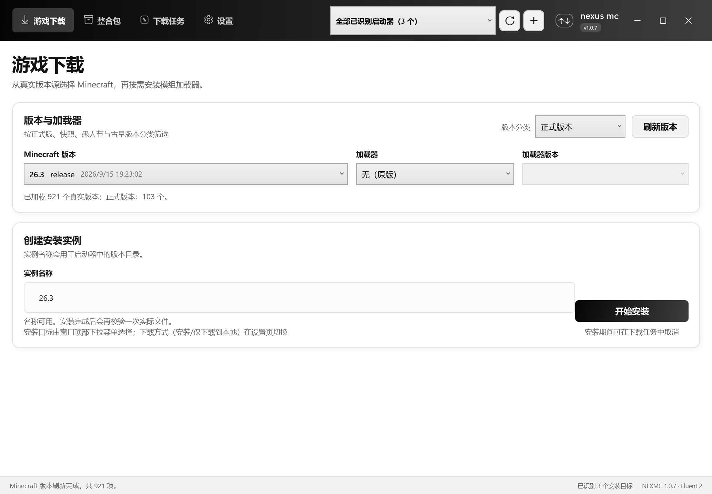
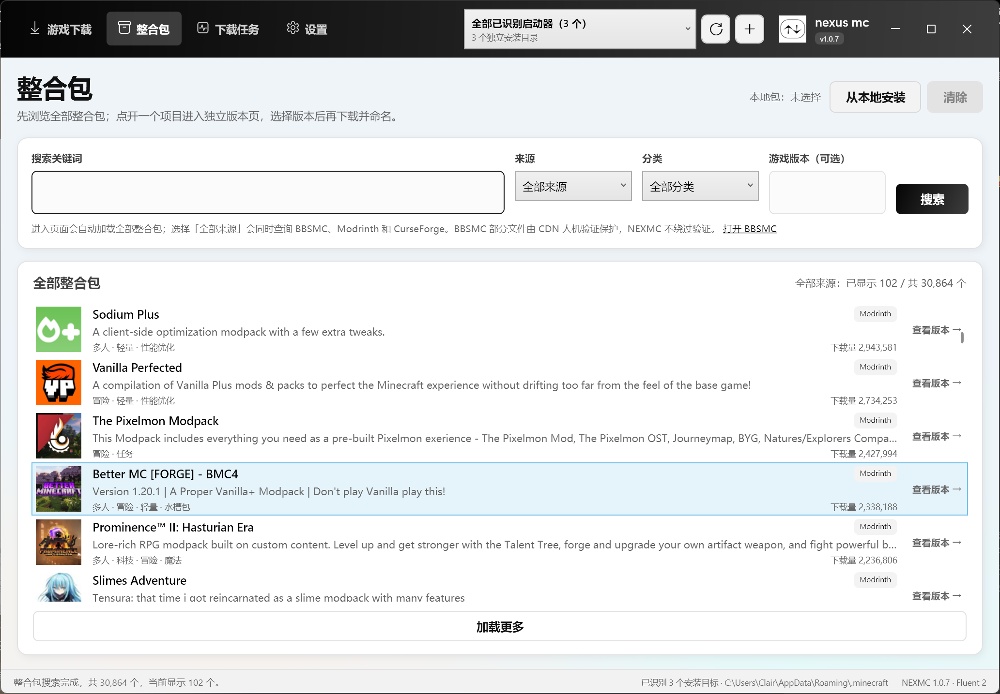
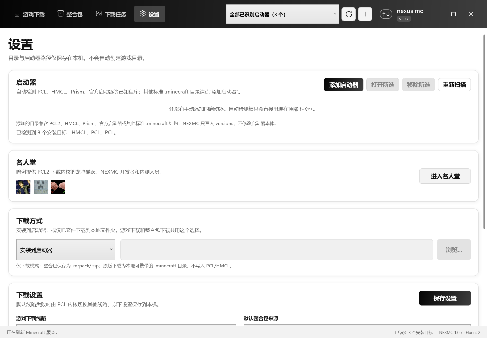

# NEXMC（nexus mc）

Windows 上的 Minecraft Java 版本与整合包下载器。基于 **PCL 2.12.7.3 下载内核**，提供黑白灰 Fluent 风格界面，不捆绑 PCL2 / HMCL 启动器本体。

[](LICENSE)
[](https://dotnet.microsoft.com/)
[](#系统要求)
[](docs/1.0.9-更新说明.md)

> NEXMC 是第三方二次创作，不是 PCL 官方版本。PCL 下载组件的版权归龙腾猫跃所有，详见 [NOTICE](NOTICE) 与 [licenses/PCL-LICENCE.txt](licenses/PCL-LICENCE.txt)。



## 功能

- **原版游戏下载**：正式版、快照、愚人节版本、古早版本分类；支持 Fabric / Forge / NeoForge。
- **整合包下载**：BBSMC、Modrinth、CurseForge 三来源；来源可勾选多选，可只选 Modrinth + CurseForge，结果按来源返回顺序逐步显示。
- **两种下载方式**：安装到启动器，或仅下载到本地（整合包保存 `.mrpack/.zip`，原版生成可携带的本地 `.minecraft`）。
- **启动器兼容**：自动识别 PCL、HMCL、Prism、官方启动器等真实启动器；显示「名称 · 已安装版本数量」，不拼接本机文件夹名。
- **添加启动器**：`.minecraft` 目录可选，只选 EXE 时会自动在 EXE 旁、用户目录等位置寻找。
- **命名**：下载整合包前弹出命名窗口，默认使用整合包原名，可修改；切换项目不会沿用上一次改名。
- **多任务**：可连续添加多个安装/下载任务，任务显示「排队中」；PCL 内核按顺序执行以避免全局路径冲突。
- **进度反馈**：完成后隐藏进度条，显示绿色对勾；失败/取消不显示。
- **仅网盘版本**：有网盘链接时打开夸克/迅雷等链接，没有则打开项目介绍页；不绕过登录或验证。
- **BBSMC 人机验证**：命中验证时自动弹出内置 WebView2 窗口；验证并下载完成后自动用本地包继续安装。
- **下载线路**：默认优先官方源，失败回退 BMCLAPI；26.x 年份版本直接走官方源，避免 BMCLAPI 逐文件跳转慢速 CDN；下载大文件时按缓存字节数判断是否真的卡死，不会因为进度不动而误中断；可设置线程数、限速、重试次数/间隔。
- **浏览位置**：从整合包版本页返回列表时保留原来的滚动位置。
- **校验**：安装完成后校验版本 JSON、客户端 JAR、libraries、assets。
- **名人堂**：设置页可查看鸣谢。





## 下载与安装

安装包已放在本仓库根目录：

```text
NEXMC-Setup-1.0.9.exe
NEXMC-Setup-1.0.9.sha256.txt
```

1. 运行 `NEXMC-Setup-1.0.9.exe`，按向导安装到当前用户目录，无需管理员权限。
2. 从开始菜单或桌面快捷方式启动。
3. 顶部下拉框选择安装目标；找不到启动器时点 `+`，选择启动器 EXE 或 `.minecraft` 目录。
4. 需要校验安装包时：

```powershell
Get-FileHash .\NEXMC-Setup-1.0.9.exe -Algorithm SHA256
```

安装包是 self-contained 构建，已经包含 .NET 10 运行时；普通用户安装后直接运行，不需要另外安装 .NET。只有从源码编译时才需要 .NET 10 SDK。

安装包未购买代码签名，Windows SmartScreen 显示「未知发布者」属于预期现象。

## 源码构建

### 系统要求

- Windows 10 / 11 x64
- [.NET 10 SDK](https://dotnet.microsoft.com/download)（10.0.x）
- [Bun](https://bun.sh/)（仅打包安装程序与生成图标时需要）
- Node.js 20+（Bun 已包含所需运行能力，通常无需单独安装）

### 构建与测试

```powershell
dotnet restore NEXMC.sln
dotnet build NEXMC.sln -c Release
dotnet test tests/NEXMC.Tests/NEXMC.Tests.csproj -c Release
```

直接运行：

```powershell
dotnet run --project src/NEXMC/NEXMC.csproj
```

### 打包安装程序

```powershell
bun install
powershell -ExecutionPolicy Bypass -File build/package.ps1
```

`package.ps1` 会优先使用 `tools\dotnet\dotnet.exe`（如果存在），否则使用 PATH 中的 `dotnet`。产物在 `dist\installer\NEXMC-Setup-1.0.9.exe`。

## 项目结构

```text
src/
  NEXMC/              WPF 应用外壳、界面、服务层
  Nexmc.Kernel/       PCL 2.12.7.3 下载内核适配与 NEXMC 门面
  MeloongCore/        PCL 依赖的基础组件
  Nexmc.Smoke/        真实安装/下载冒烟夹具
tests/
  NEXMC.Tests/        单元测试
assets/               徽标、名人堂头像、安装图标
build/                electron-builder / NSIS 打包
docs/                 更新说明、截图、项目总结
licenses/             第三方许可原文
scripts/              资源渲染与构建辅助脚本
```

## 名人堂

| 成员 | 身份 | 链接 |
|---|---|---|
| huogoooo | NEXMC 内测人员 | — |
| 龙腾猫跃（LTCat） | PCL2 下载内核作者 | [爱发电](https://afdian.com/a/LTCat) · [PCL](https://github.com/Meloong-Git/PCL) |
| username-xusir | NEXMC 开发者 | [GitHub](https://github.com/username-xusir) |

在软件「设置 → 名人堂」中可以看到完整鸣谢页；点击龙腾猫跃或 username-xusir 的头像会使用默认浏览器打开对应页面。

## 许可证与第三方组件

- NEXMC 原创文件：**MIT License**，见 [LICENSE](LICENSE)。
- PCL 下载内核与 `src/Nexmc.Kernel/Upstream/**`：**不属于 MIT 范围**，保留 PCL 原作者权利；见 [NOTICE](NOTICE) 与 [licenses/PCL-LICENCE.txt](licenses/PCL-LICENCE.txt)。
- 其他第三方组件：见 [THIRD_PARTY_LICENSES.md](THIRD_PARTY_LICENSES.md)。
- NEXMC 不包含 PCL / HMCL 启动器本体，不包含游戏账号、破解或付费内容。

## 已知限制

- PCL 内核的安装阶段共享全局路径状态，因此多个任务目前是**排队执行**，不是并行安装。
- BBSMC 封面 CDN 在部分网络不可达时显示首字母占位，不影响搜索和安装。
- 安装包未代码签名。
- BBSMC 部分文件受 CDN 人机验证保护，NEXMC 只弹出验证窗口，不绕过验证。

## 反馈

- Issue：https://github.com/username-xusir/nexusmc/issues
- 项目主页：https://github.com/username-xusir/nexusmc

---

**NEXMC 不是 PCL 官方版本，也不代表 PCL、HMCL、BBSMC、Modrinth 或 CurseForge 官方。**
